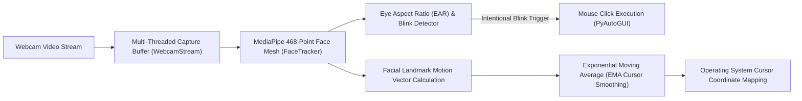

# 👁️ EyeMousePro — AI Eye-Gaze & Facial Landmark Mouse Controller

[](https://python.org)
[](https://opencv.org)
[](https://developers.google.com/mediapipe)
[]()
[](LICENSE)

A lightweight, multi-threaded, lag-free assistive mouse controller that tracks real-time head poses and eye gaze via webcam. Control your mouse cursor hands-free and execute left-clicks with intentional blinks.

---

## 📐 System Architecture



---

## 🌟 Key Features

1. **Multi-Threaded Video Pipeline:**
   - Dedicated camera polling thread (`WebcamStream`) isolates frame retrieval from image processing, ensuring a solid 60 FPS zero-jitter cursor tracking.

2. **Jitter-Free Exponential Smoothing:**
   - Employs an exponential moving average (`smoothening=7`) filter to eliminate microscopic sensor noise and micro-tremors, making precision desktop clicking effortless.

3. **Intentional Blink Detection (EAR):**
   - Monitors the Eye Aspect Ratio (EAR) across frame thresholds to distinguish between involuntary biological blinks and intentional mouse-click gestures.

4. **Zero-Warning Production Logging:**
   - Suppresses low-level Protobuf and TensorFlow C++ XNNPACK engine warnings for a clean command-line developer experience.

---

## 📁 Repository Structure

```text
EyeMousePro/
├── camera.py        # Multi-threaded background webcam grabber
├── tracker.py       # MediaPipe Face Mesh landmark extraction & EAR calculation
├── controller.py    # Screen boundary translation, smoothing, & PyAutoGUI clicks
├── main.py          # Application entrypoint & runtime loop
└── requirements.txt # Python dependencies
```

---

## 🚀 How to Run

1. **Install Dependencies:**
   ```bash
   pip install -r requirements.txt
   ```

2. **Launch Controller:**
   ```bash
   python main.py
   ```

### 🎮 Controls:
* **Head Movement:** Moves mouse cursor across your monitor.
* **Left Eye Blink:** Performs a left mouse click.
* **Press `q`:** Safely exits camera feed and restores normal mouse control.

---

## ⚖️ Intellectual Property & License

**Copyright (c) 2026 Kartik. All Rights Reserved.**

This repository and its source code are published for **viewing, evaluation, and portfolio demonstration purposes only**. No permission is granted to reproduce, distribute, modify, deploy, or commercially exploit this software. See the [LICENSE](LICENSE) file for complete legal terms.
